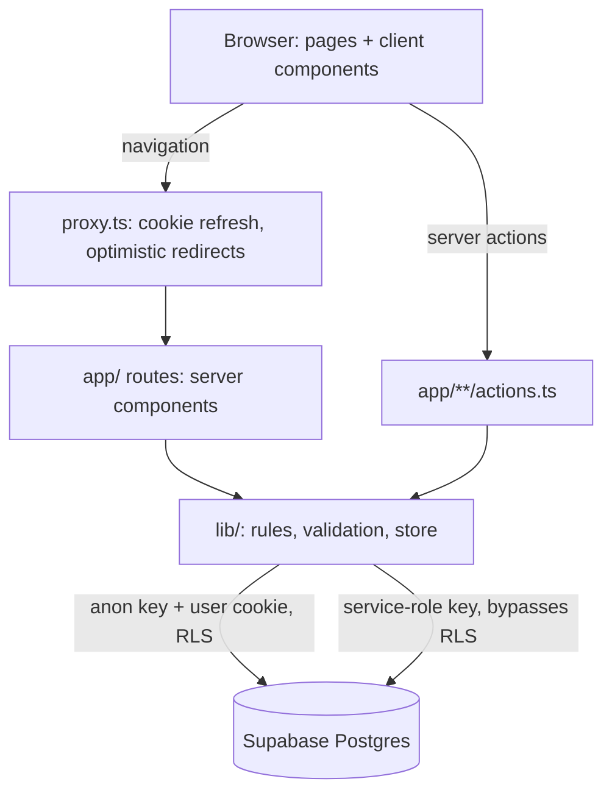

# Architecture Overview

**In plain English:** Cut Labz is one Next.js app on Vercel talking to one Supabase project (a Postgres database plus login service). Pages are mostly rendered on the server; the browser gets small interactive pieces (the booking wizard, forms). All business rules live in `lib/` on the server, and the database enforces the most important ones again.

## Stack
| Layer | Tech | Notes |
|---|---|---|
| Framework | Next.js 16.4.6, App Router, `proxy.ts` | [[Cache Components]] on (`next.config.ts`); [[Tooling and config]] |
| UI | React 19.3, Tailwind 4.3, framer-motion | [[Visual style rules]], [[Root layout and styles]] |
| Data + auth | Supabase Postgres + Auth via `@supabase/ssr` | [[Database hub]], [[Supabase clients]] |
| Hosting | Vercel (no `vercel.json`; settings unverified) | [[Environment and deployment]] |
| Tests | Node test runner via `tsx` | [[Test suite overview]] |

## Layers

| Layer | Folder | Notes / hub |
|---|---|---|
| Edge gate | `proxy.ts` | [[Proxy request gate]], [[Auth gating]] |
| Routes (pages) | `app/` | [[Customer UI hub]], [[Admin hub]], [[Accounts hub]] |
| Actions | `app/**/actions.ts`, `components/**/actions.ts` | [[Server action]] |
| Components | `components/` | client UI, see area hubs |
| Domain logic | `lib/*.ts` | [[Booking engine hub]], [[Membership rules]] |
| Storage | `lib/store.ts`, `lib/catalog-db.ts`, `lib/admin/*` | [[Store Supabase]], [[Store memory fallback]] |
| Database | `supabase/schema.sql` | [[RLS matrix]], [[Row Level Security]] |

## Three user groups
| Who | Entry | Guard |
|---|---|---|
| Visitor | `/`, `/terms`, `/login`, `/signup` | none |
| Customer | `/book`, `/account/**` | [[requireCustomer]] |
| Admin | `/admin/**` | [[requireAdmin]] |

## Key design choices
- Dates + minutes, shop-local: [[Time model]].
- Server recomputes everything the browser sends: [[Trust boundary]].
- DB constraints are the final word on clashes: [[Double-booking guard]], [[Membership period]].
- Without Supabase env, dev/test use an in-memory store; production refuses (`lib/store.ts:81-89`).
- Only the catalog is cached (`'use cache'`, tag `catalog`); everything personal is dynamic.

Next: [[Security Model]], [[Request Lifecycles]], [[Glossary]] | [[00 Index]].
