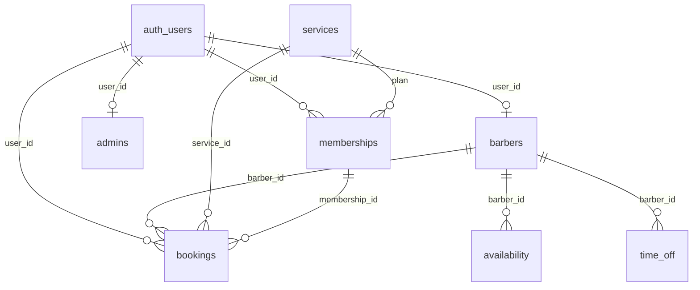

# Database hub

**In plain English:** all data lives in one Supabase Postgres database. The whole schema is a single file, `supabase/schema.sql` (215 lines), that mirrors what was applied to the live project. Rules about who may read or write each table are enforced inside the database itself ([[Row Level Security]]). Back to [[00 Index]].

knowledge_chunks exists in the live database but is unused by the app and absent from supabase/schema.sql

## Notes in this area
| Note | Covers |
|---|---|
| [[Table barbers]] | staff, active flag, optional login link |
| [[Table services and addons]] | priced catalog: memberships, one-offs, extras |
| [[Table availability]] | weekly hours per barber |
| [[Table time_off]] | holidays, private reason |
| [[Table bookings]] | appointments, `no_overlap` guard |
| [[Table memberships]] | dated membership periods |
| [[Table admins]] | admin allow-list |
| [[DB functions]] | `private.is_admin()`, `public.replace_availability()` |
| [[RLS matrix]] | table x role access grid |
| [[Schema history and seed data]] | statement order, seed rows, applying |

## ER diagram

`bookings.addon_ids` is a `text[]` of addon ids, not a foreign key (see [[Table services and addons]]).

## Who talks to the database
| Client | Key | Subject to RLS | Docs |
|---|---|---|---|
| Admin client | [[Service-role key]] | no (bypasses) | [[Supabase clients]], [[Store Supabase]] |
| Server client (cookies) | [[Anon key]] + user JWT | yes | [[Supabase clients]], [[Admin auth]], [[Viewer and session]] |

Key design points: the [[Double-booking guard]] is a Postgres exclusion constraint; times are shop-local integers ([[Time model]]); the app trusts the DB for invariants and re-checks inputs server-side ([[Trust boundary]]). See also [[Security Model]] and [[Architecture Overview]].

## Known gaps
See each table note; summary in [[Schema history and seed data#Known gaps]].
